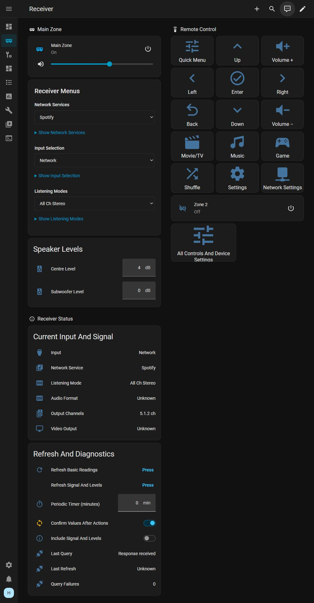

# Current Onkyo Extended dashboard

[Raw dashboard YAML](onkyo-extended.yaml) · [Full dashboard screenshot](onkyo-extended.jpg)

Exported from the Home Assistant Raw configuration editor on 14 November 2026, after the receiver menus and remote buttons were rearranged. The live dashboard was not modified during this export.

The layout is copied from the current dashboard. Before pasting the YAML into your own dashboard raw editor:

1. Install Onkyo Extended and register `/onkyo_extended/choice-card.js?v=020-domain` as a JavaScript module in dashboard resources.
2. Replace `onkyo_extended_your_receiver_` with the entity-ID prefix used by your receiver. Check each entity ID against your installation.
3. Replace `YOUR_ONKYO_DEVICE_ID` in the device-settings link with your device ID, or change/remove that navigation button.

The public YAML uses placeholders in place of the original receiver-address prefix and device ID. It contains no passwords or API credentials. The screenshot shows observed states at capture time; it does not verify every control or audio playback. This integration remains only partially tested on the HT-R997.

